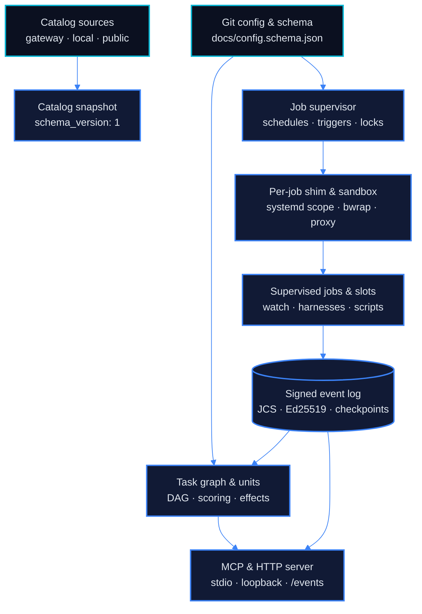

<!-- markdownlint-disable MD013 MD033 MD036 MD041 -->
<!-- A centred header needs inline HTML, a banner image, a bold tagline and
     badge lines past 80 columns, so those four rules are off for this file. -->
<div align="center">

  

  <!-- README-STANDARD badge block: one group, fixed order (VMAFx docs/README-STANDARD.md) -->
  <!-- 1 release/version -->
  [](https://github.com/tekmora/epitrop/releases)
  <!-- 3 security/scorecard -->
  [](https://coderabbit.ai)
  <!-- 4 standards -->
  [](AGENTS.md)
  [](CONTRIBUTING.md)
  <!-- 5 licence -->
  [](LICENSE)
  <!-- 6 support -->
  [](https://github.com/sponsors/lusoris)
  [](https://ko-fi.com/lusoris)

  **Agent runtime and task-graph engine for the Tekmora ecosystem**

  *File-based, Git-native control plane, sandboxed job runner and model catalog, governed by Praetor*

</div>

Epitrop reads its organisation, routines and budgets from files in Git and
rebuilds state from an append-only, Ed25519-signed event log, without a
database setup wizard. Status: early. Today the repository holds the model
catalog (`catalog/`, `cmd/epitropctl`, `internal/sources/`), moved from
`cordanaLLM/praetor` with its history, together with the Go control plane
(`cmd/epitropctl`, `cmd/epitrop-server`), the signed event log, the acyclic task
graph, the sandboxed job supervisor, the agent slot runner and the MCP server.
The runtime is planned in milestones 0.1 to 0.6; see the
[roadmap](docs/roadmap.md).

**[Full documentation](https://tekmora.github.io/epitrop/)** · [Documentation source](docs/index.md)

---

## Why Epitrop

Epitrop keeps runtime state in Git and an append-only event log while isolating
task execution from the control plane (`docs/epitrop-description-v2.md`,
`docs/architecture-v2.md`):

- **Git-native configuration, no relational database**: process configuration is
  validated against [`docs/config.schema.json`](docs/config.schema.json) before
  decoding, and organisation, routines and budgets live in files in Git
  (ADR-001; Paperclip is not required).
- **Event-sourced state (RT-04)**: every task-graph edit, work-unit transition,
  job lifecycle event and outbound side-effect claim is recorded in a
  JCS-canonicalised (RFC 8785), Ed25519-signed event log (`internal/eventlog`)
  with segment rotation, Git checkpoint commits onto `refs/epitrop/events` and
  signed base compaction.
- **Acyclic task graph and deterministic frontier**: `internal/graph` enforces
  Kahn acyclicity, bounded depth and staged rollback, and `internal/score`
  orders ready work units deterministically from event-log records alone.
- **Control-plane isolation and sandboxed supervision (RT-03)**: declared
  background jobs and headless agent slots (`internal/supervisor`,
  `internal/slot`) start through a per-job shim in Linux `systemd-run` user
  scopes (`MemoryMax`, `MemoryHigh`, `CPUWeight`, `TasksMax`) and `bubblewrap`
  sandboxes with `none`, `egress` or Unix-socket `proxy` network modes
  (`internal/egressproxy`), lock-backed liveness and read-only bound logins.
- **Deterministic edges and at-most-once side effects (RT-01, RT-02)**:
  `internal/edges` checks model calls for temperature 0 and JSON Schema
  validation, `internal/effects` runs each `(task_id, action_type)` side effect
  at most once, and `internal/broker` provides log-first fan-out with bounded
  subscriber queues and dead-letter classification (`internal/jobfailure`).
- **Router-alias model routing and measured budgets**: every model call goes
  through a router alias over one dynamic accelerator pool, platform budgets
  (`internal/budget`) read the Praetor efficiency ledger (`internal/ledger`),
  and the model catalog collects live usage windows and burn rates without
  silent fallbacks.
- **Planned vector kernel and operator UI**: a Rust vector kernel (SIMD cosine
  and Euclidean skill matching over `f32`, `f16` and `i8` vectors) and a
  Svelte 5 runes operator UI complete the planned stack.

### The name

The runtime is called **Epitrop** (eh-PEE-trop), from Greek *epitropos*, the
appointed trustee. Tekmora, the family the name belongs to, comes from Greek
*tekmor*: a set goal, and the sign that shows the way to it; said *TEK-mo-ra*.
The repository was first named `tribunus`, in another organisation; its old
address redirects.

## Get started

Build and test the repository from a checkout:

```bash
go build -v ./...
go vet ./...
go test -race ./...
```

Run the first CLI command (`epitropctl version` or `epitropctl sync`) and the
operator subcommands:

```bash
epitropctl sync [--sources=a,b] [--out=file]
epitropctl show [--in=file]
epitropctl headroom --max-age=duration [--in=file]
epitropctl claude-limits [--claude-projects-dir=dir]
epitropctl schema
epitropctl version
epitropctl jobs start|status|stop --config=file [name]
epitropctl jobs history --config=file [--since=RFC3339] [name]
epitropctl jobs supervise --config=file [--poll-interval-seconds=1]
```

`epitropctl sync` writes a versioned catalog snapshot with `schema_version: 1`.
The contract is described by `catalog/snapshot.schema.json`, and
`epitropctl schema` prints the embedded copy for downstream pin checks.
`epitropctl version` prints the release version, or `dev` for a source build.
`epitropctl jobs supervise` runs until SIGTERM or an interrupt, which end it
with exit 0, so a host service unit can hold it.
Releases, their signed artefacts and how to verify them are described in
[Releasing](docs/releasing.md).

`epitropctl` exports OpenTelemetry traces and metrics over OTLP once
`OTEL_EXPORTER_OTLP_ENDPOINT` or a signal-specific endpoint is set. With no
endpoint set, nothing is exported. [Telemetry](docs/telemetry.md) lists the
spans and metrics. `epitrop-server --config=file` serves the run record over the
Model Context Protocol; see [MCP server](docs/mcp-server.md).

## At a glance



## Guides and reference

| Task | Documentation |
| --- | --- |
| Start working in the repository and inspect package boundaries | [Agent onboarding](docs/agent-onboarding.md) |
| Read the project overview and six design pillars | [Description](docs/epitrop-description-v2.md) |
| Understand the Go control plane, event log, agent slots and RT-01 to RT-04 | [Architecture](docs/architecture-v2.md) |
| Navigate existing packages, binaries and planned directories | [Repository layout](docs/repository-layout-v2.md) |
| Install `epitropctl`, sync the model catalog and inspect source limits | [Catalog data sync](docs/data-sync.md) |
| Serve the run record, probes and `/events` stream over MCP and loopback HTTP | [MCP server](docs/mcp-server.md) |
| Export OpenTelemetry spans and metrics over OTLP | [Telemetry](docs/telemetry.md) |
| Run background jobs in parallel before switching over | [Cutover 1](docs/cutover-1.md) |
| Cut, sign and verify releases and check upgrade fixtures | [Releasing](docs/releasing.md) |
| Track milestones 0.1 to 0.6 and Praetor interfaces | [Roadmap](docs/roadmap.md) |
| Browse the verified reference links behind the design | [Sources](docs/sources-list-v2.md) |
| Review accepted architectural decision records | [ADR index](docs/adr/README.md) |

## Contribute

Start with [CONTRIBUTING.md](CONTRIBUTING.md) for the HISS rules, 3D testing
requirements, Conventional Commits and local verification. Read
[Agent onboarding](docs/agent-onboarding.md) for the package map.

- [Report a bug or track work](https://github.com/tekmora/epitrop/issues)
- [Ask a question or join discussions](https://github.com/tekmora/epitrop/discussions)
- [Report a security vulnerability privately](SECURITY.md) (GitHub private
  vulnerability reporting)

## Support

Sponsor the work on [GitHub Sponsors](https://github.com/sponsors/lusoris) or
[Ko-fi](https://ko-fi.com/lusoris), any amount; no support or priority is sold.

## Roadmap and releases

- [Roadmap and milestones 0.1 to 0.6](docs/roadmap.md)
- [Releases and signed downloads](https://github.com/tekmora/epitrop/releases)
- [Changelog](CHANGELOG.md)
- [Release process and verification](docs/releasing.md)

## Upstream and licence

EUPL-1.2, for code and documents alike. See [`LICENSE`](LICENSE) and
[`REUSE.toml`](REUSE.toml). Third-party code that `epitropctl` includes, with
the notice each licence asks to carry, is listed in [`NOTICE.md`](NOTICE.md).
The Go control plane builds on pinned
[golusoris](https://github.com/golusoris/golusoris) modules under EUPL-1.2
([ADR-0004](docs/adr/0004-golusoris-pinned-base.md)), and the model catalog
moved from [`cordanaLLM/praetor`](https://github.com/cordanaLLM/praetor) with
its history.

## Standards and governance

This repository conforms to High-Integrity Systems Standards (HISS-21).

<!-- praetor:readme-governance:start -->
[![Documentation Governance][praetor-docs-badge]][praetor-docs-runs]

Praetor manages this repository's declared governance policy. This managed
block records adoption state; it is not a verification certificate.

**Verification**: `make verify-all` runs the repository's configured
verification cascade.

**HISS Audit**: `praetorctl audit` enforces policy, generated-surface
integrity, and the debt ratchet.

**Context Sync**: `praetorctl compile-context --verify` verifies every
generated agent context against `AGENTS.md`.

**Documentation**: `make docs-lint` enforces locked Markdown style and the
private scratch-link policy.

**Debt Baseline**: `.standards-baseline.json` anchors the debt ratchet at
4 recorded infractions; audit forbids growth.

[praetor-docs-badge]: https://github.com/tekmora/epitrop/actions/workflows/praetor-docs.yml/badge.svg
[praetor-docs-runs]: https://github.com/tekmora/epitrop/actions/workflows/praetor-docs.yml
<!-- praetor:readme-governance:end -->
